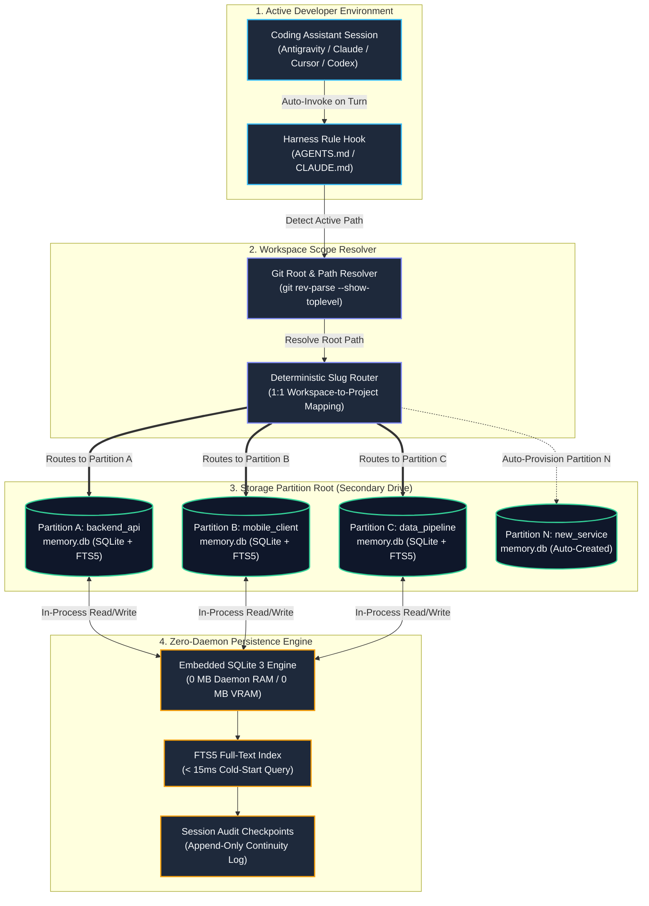

# isolated-agent-memory

Deterministic, workspace-isolated persistent memory for AI coding agents.

`isolated-agent-memory` provides persistent ground truth for local developer agents (Antigravity, Claude Code, Cursor, Codex). It eliminates agent context loss across sessions and reboots without running background daemons or leaking state across unrelated repositories.

---

## Architectural Motivation

Local AI developer agents are fundamentally stateless between sessions. When a session terminates, context residing in the active context window or process RAM is destroyed.

Existing agent memory implementations typically introduce two structural problems:

1. **Cross-Project State Contamination:** Common vector-store backends aggregate embeddings into a flat, shared index. Facts established in Repository A (e.g., API keys, schema constraints, script parameters) leak into queries executed in Repository B.
2. **Runtime Overhead:** Frameworks relying on external daemon services (PostgreSQL, Docker containers, or remote SaaS endpoints) introduce persistent CPU/RAM overhead, network latency, and unnecessary failure points on local developer hardware.

`isolated-agent-memory` resolves this by using an embedded, filesystem-partitioned architecture:



> **Interactive Architecture Diagram:** Open [`assets/architecture.html`](assets/architecture.html) in your browser for the full interactive layout with pan/zoom and light/dark theme toggles.

---

## Design Principles

* **Strict Boundary Isolation:** Each workspace resolves deterministically to its own SQLite database. Queries never traverse partitions.
* **Zero Runtime Daemon:** Implemented as an embedded Python module. 0 MB background RAM, 0 MB GPU VRAM, and zero network calls.
* **Secondary Storage Offloading:** Designed to persist state on secondary storage (`D:\`, external NVMe, or custom path) to prevent primary OS drive saturation.
* **Sub-Millisecond Cold Starts:** Full-Text Search (FTS5) and indexed key-value lookups complete in under 15 ms on startup.
* **Hands-Off Execution:** Agent harnesses auto-load relevant memory upon session initialization through standardized rule files (`AGENTS.md`, `CLAUDE.md`).

---

## Installation

```bash
git clone https://github.com/Razae786/isolated-agent-memory.git
cd isolated-agent-memory
pip install -e .
```

To initialize your persistent storage directory on a chosen drive:

```powershell
# Windows
.\install.ps1 -StorageDrive "D:"

# Linux / macOS
./install.sh --storage-dir "/Volumes/Storage/AgentMemory"
```

---

## Agent Harness Integration

To enable zero-command automated memory for your agents, add the following directive to your workspace or global rules file (`AGENTS.md` or `CLAUDE.md`):

```markdown
<!-- Persistent Memory Protocol -->
Every workspace maintains its own isolated persistent database on secondary storage.
1. On session start: Detect the active workspace path, inspect its partition in <STORAGE_ROOT>/projects/<project_name>/memory.db, and ingest active ground-truth facts.
2. During session: When an architectural decision, hardware constraint, or schema change is agreed upon, record it to memory.db via `vault add`.
3. Never mix facts across different project namespaces.
```

---

## Command Line Interface

While agents manage read/write operations silently, a terminal utility is provided for inspection and manual maintenance:

| Command | Description |
|---|---|
| `vault list` | Enumerate all project partitions and active fact counts. |
| `vault recall [query]` | Execute an FTS5 search across the active project's database. |
| `vault add --id <key> --category <cat> --fact <text>` | Insert or update an architectural decision. |
| `vault checkpoint --summary <text> [--next <text>]` | Record a session checkpoint for cross-session continuity. |
| `vault dump` | Export all active records for the current project as Markdown. |

### Example Query

```bash
$ vault recall auth
[backend_api] Found 2 facts matching 'auth':
  - [SECURITY] auth_jwt: Uses Ed25519 asymmetric JWT tokens with 15-minute expiration.
    Details: Refresh tokens are stored in Redis with 7-day TTL and rotation on each refresh.
```

---

## Database Schema

Each isolated database is an SQLite 3 file containing:

* `facts`: Normalized key-value table containing fact identifiers, categories, status flags, and timestamps.
* `facts_fts`: SQLite FTS5 virtual table for sub-millisecond keyword and token search.
* `session_checkpoints`: Append-only audit log tracking accomplishments, modified files, and next actions.

---

## Technical Specifications

* **Language:** Python 3.9+
* **Database Engine:** Embedded SQLite 3 with FTS5 extension
* **Memory Footprint:** 0 MB idle resident RAM
* **Cold Lookup Latency:** < 15 ms
* **Default Database Footprint:** ~48 KB per partition
* **License:** MIT
